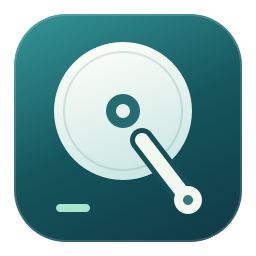
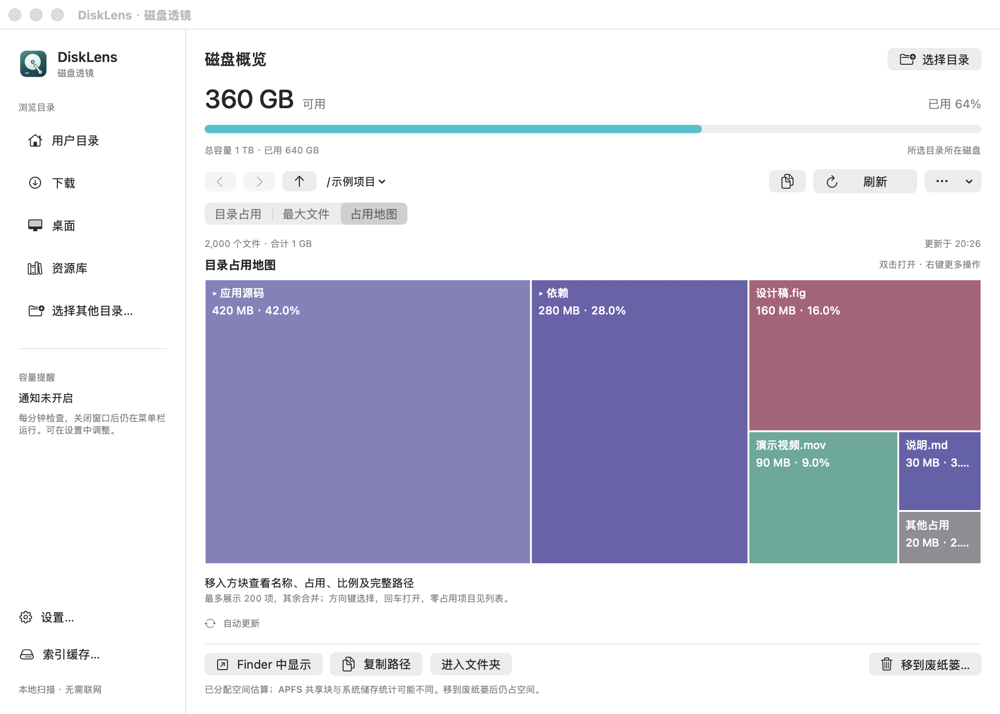
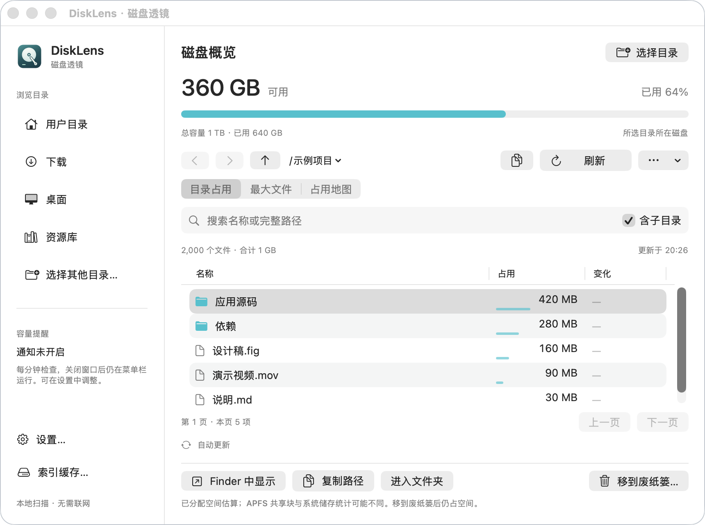
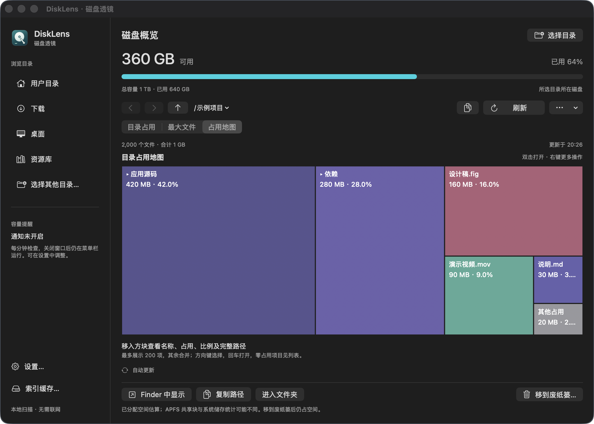
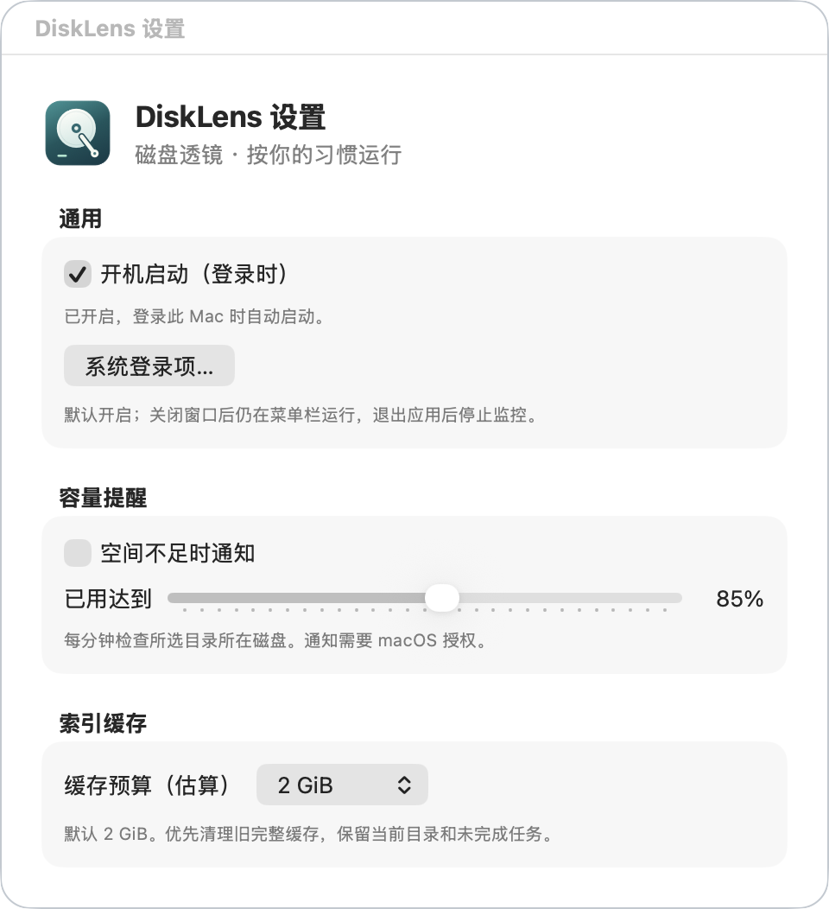

<p align="center">
  
</p>

# DiskLens

[简体中文](README.md) | English

[Download for macOS (Apple Silicon)](https://github.com/lxfu1/disk-lens/releases/download/v0.1.0/DiskLens-0.1.0-arm64.dmg) · [Release notes and checksums](https://github.com/lxfu1/disk-lens/releases/tag/v0.1.0)

See where your disk space goes and find large files. DiskLens is a local macOS disk analyzer with directory listings, a largest-files view, and an interactive treemap. It keeps its index up to date using filesystem events.

Native SwiftUI / AppKit interface · Local SQLite index · No third-party runtime dependencies · No accounts, uploads, or telemetry · [MIT](LICENSE)



> Screenshots render the actual app interface with synthetic directories, files, and capacity data. The current app interface is in Simplified Chinese; English documentation does not imply English UI localization.

## Features

- **Three views of disk usage**: browse directory totals, find the largest files, or compare usage through treemap areas. The map supports hover details, double-click navigation, and keyboard selection.
- **Full indexing and incremental updates**: the initial scan builds a cache, then FSEvents supplies changes. Pause and resume scans, recover interrupted work, and browse partial results that have already been saved.
- **Search and navigation**: search names or full paths, include subdirectories, page through results, and navigate directory history or ancestor paths. Background updates preserve the current list and browsing controls.
- **File actions**: reveal items in Finder, copy paths, and choose an application to open a file. Moving an item to the Trash requires confirmation and a file identity check.
- **Menu bar and settings**: check free space, configure capacity alerts and launch at login, and manage the index cache. The app remains available in the menu bar after its window closes.

## Download and install

Download `DiskLens-0.1.0-arm64.dmg` from [GitHub Releases](https://github.com/lxfu1/disk-lens/releases/tag/v0.1.0), open it, and **drag DiskLens into Applications**. Launch it from Applications. This preview requires **macOS 13+ and Apple Silicon (M-series)**; an Intel build is not included. Quit the old process before updating.

### macOS security warnings

**The current package is ad-hoc signed, without Apple Developer ID signing or notarization.** After a browser download, macOS Gatekeeper may block the first launch with an “unidentified developer” or “Apple cannot check it for malicious software” warning. This distribution has not passed Apple's security review.

Only consider allowing it if you have confirmed that the file came from this repository's Release and you trust the app. After attempting to launch it once, open **System Settings → Privacy & Security** and choose **Open Anyway** for the corresponding blocked app, if offered. Availability depends on the macOS version and device management policy. You do not need to disable Gatekeeper system-wide.

If macOS reports that the file is “damaged,” download it again and verify it against the Release's `SHA256SUMS.txt` rather than assuming a false alarm. If it explicitly reports detected malware, do not proceed. SHA-256 verifies download integrity; it does not replace Apple notarization or a security review.

Download the DMG and checksum file into the same directory, then run there:

```sh
shasum -a 256 -c SHA256SUMS.txt
```

## Build from source

Requires **macOS 13 or later** and Apple Command Line Tools:

```sh
xcode-select --install
```

Clone the repository and build:

```sh
git clone https://github.com/lxfu1/disk-lens.git
cd disk-lens
bash scripts/build.sh
open dist/DiskLens.app
```

The build produces `dist/DiskLens.app` for the current machine's architecture with an ad-hoc signature. Neither source builds nor the preview package provide Developer ID signing, notarization, or in-app automatic updates.

You can move the app to Applications and keep it at a stable location. A normal first launch does not automatically scan your entire home directory. Select a directory or click “开始分析” (Start analysis) to build its index.

To analyze a specific directory in a newly launched process, quit any running instance first, then run:

```sh
open dist/DiskLens.app --args --scan /path/to/folder
```

After rebuilding, quit the old process and reopen the app. Closing the window does not quit DiskLens. Use “退出 DiskLens” (Quit DiskLens) in the menu bar, press `⌘Q`, or run the following while the app is running:

```sh
osascript -e 'tell application id "local.disklens.app" to quit'
open dist/DiskLens.app
```

## Usage

### Browse, search, and copy

“目录占用” (Directory usage) shows immediate children. “最大文件” (Largest files) shows regular files in the current directory and its subdirectories. Each page contains up to 200 items. Search accepts names and full paths; “含子目录” (Include subdirectories) controls the search scope in the directory view.

The entire sidebar navigation row is clickable. Clicking the current directory again preserves your search, selection, and results. Use the path menu to jump to an ancestor directory, or the back and forward buttons to revisit locations. After copying the current path with the top button, a checkmark and “已复制路径” (Path copied) appear beside the action for about two seconds. The bottom “复制路径” (Copy path) button copies the selected item's full path.

Background updates retain existing results and browsing controls, with animation confined to the status icon. Actions on old results are restricted during a search or page change. Failed queries can be retried; if an index change invalidates a page cursor, the app returns to the first page and shows a notice.



### Treemap

Rectangle areas represent shares of allocated space. Hover to see size, percentage, and path. Hover and selection feedback use opacity changes; a file's context menu offers Open With, Reveal in Finder, and Copy Path.

The map displays the largest 200 items and groups the rest into “其他占用” (Other usage). Double-click that area to return to the list with search filtering cleared. Use the list to inspect zero-size items. Results remain provisional while indexing is incomplete and may change during aggregation or hard-link reconciliation.

<details>
<summary>View dark mode</summary>



</details>

### Pause, resume, and rebuild

Scanning and updates can be paused. While paused, switching directories, navigating history, and searching only read cached data. A directory without a cache waits for explicit analysis; navigation does not resume scanning. Click “继续分析” (Continue analysis), or press `⌘R`, to resume the current directory. The paused state is preserved for the current app session.

“刷新” (Refresh) requests delivery of buffered filesystem events. “重建索引…” (Rebuild index) rescans the containing index scope, which may be larger than the displayed subdirectory. The app confirms that scope before proceeding. Rebuilding can reconcile results after access permissions change.

### Settings and cache

Open settings from the sidebar, app menu, or `⌘,`:

- **Launch at login**: requested by default on first launch; subsequent choices to disable it are respected. If macOS requires approval, settings provide a link to the system's Login Items page.
- **Capacity alerts**: off by default. Enabling them requests notification permission. The selected directory's disk capacity is checked once per minute.
- **Cache budget**: the default estimated budget is 2 GiB. Old, complete index scopes are removed first; the current scope and unfinished tasks are protected, so this is not a hard disk usage limit.

Open “索引缓存…” (Index cache) in the sidebar to inspect the database, write-ahead log, reclaimable space, and migration backup. Clearing index caches does not delete user files.

<details>
<summary>View settings</summary>



</details>

### Keyboard shortcuts

| Shortcut | Action |
| --- | --- |
| `⌘O` | Choose a directory |
| `⌘R` | Refresh changes / resume after pausing |
| `⌘F` | Search |
| `⌘[` / `⌘]` | Back / forward |
| `⌘↑` | Parent directory |
| `⌘,` | Settings |
| Arrow keys / Return / Esc | Select / open / clear selection in the map |
| `⌘Q` | Quit the app |

## Data and measurement limits

The index stores file metadata only, under `~/Library/Application Support/DiskLens/`. Preferences use the `local.disklens.app` domain. DiskLens does not read file contents for analysis or upload its index.

Usage is based on allocated blocks, with hard links counted once within an index scope. The scanner does not follow directory symbolic links or cross filesystems. APFS shared blocks, snapshots, and system data can cause differences from macOS storage reports: **scan totals are not a promise of reclaimable space**. Unreadable and cross-volume locations are reported as gaps. Desktop, Documents, Downloads, and other protected locations may require macOS privacy permission.

Moving items to the Trash does not immediately free space, and DiskLens never empties the Trash automatically. Operations on protected system paths, paths outside the current scope, or files whose identity has changed are rejected.

The current index format is schema v5. If you used a local development build with a v2/v3/v4 database, quit the app before running `python3 -B scripts/migrate-index.py`. Migration keeps a `.pre-v5` backup and requires additional disk space. See [Index architecture](docs/ARCHITECTURE.md) (Chinese) for migration, rollback, and measurement details.

## Development and feedback

- [Contributing guide](CONTRIBUTING.md) (Chinese): modules, targeted checks, and screenshot regeneration.
- [Report an issue](https://github.com/lxfu1/disk-lens/issues): include your app version, reproduction steps, and redacted screenshots. Do not upload real index databases or private file listings.

DiskLens is open source under the [MIT License](LICENSE).
