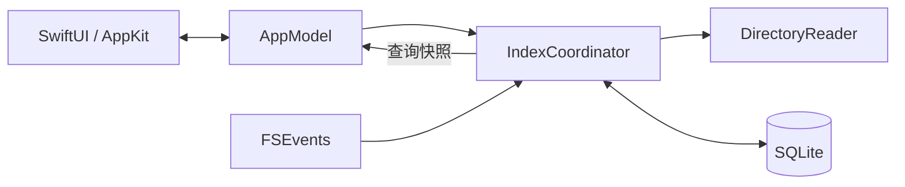

# 索引架构与统计边界

## 模块与数据流

DiskLens 是原生 macOS 应用，不包含 WebView 或后端服务。构建入口为 `scripts/build.sh`，不依赖包管理器。

| 模块 | 职责 |
| --- | --- |
| `DiskLensApp` / `AppModel` | 应用生命周期、菜单栏、导航、查询与交互状态 |
| `ContentView` / `TreemapView` / `SettingsView` | 目录列表、占用地图与设置；图标共用 `AppBrand` |
| `IndexCoordinator` | 分离写入、查询和事件队列，取消过期查询，向主线程交付快照 |
| `DiskIndex` / `IndexSchema` | SQLite 存储、聚合、分页、缓存维护与共享迁移定义 |
| `DirectoryReader` / `FileEvents` | 批量元数据枚举与 FSEvents 事件收集 |
| `FileActions` / `LoginStartup` | 文件打开与路径复制、系统登录项适配 |

打开目录时将路径与查询条件一起交给协调器，避免重复查询和取消。快速导航取消过期查询，快照交付时再次确认当前目录；重复点击当前目录保留已有结果与搜索。暂停时导航只查询缓存，显式继续才恢复扫描。

前台结果切换与后台数据刷新分别处理：搜索、翻页限制旧结果操作；后台更新保留表格、选择和滚动位置。状态图标使用独立的单调时钟动画，短任务完成当前一圈再停止，避免整块内容闪动。

## 增量更新机制

- **首次建索引**：macOS 优先用 `getattrlistbulk` 和 64 KiB 缓冲批量获取普通文件元数据；目录、符号链接、特殊文件和缺失字段回退 `lstat`，不支持批量接口的文件系统使用 `readdir`。校验返回字段与记录边界，不跟随目录符号链接。空目录的新文件复用已知父 ID/路径、直接插入、整数绑定，并将枚举标记合并写入；脏目录在事务内去重。首次新增文件的占用随批次更新目录及祖先，目录枚举完成时校准；硬链接去重前显示暂计值。状态区分枚举与写入、硬链接校准、目录汇总和缓存整理。
- **可恢复批次**：待处理目录、硬链接及汇总任务持久化。约每 1,024 次节点变更、累计 1 MiB 新节点路径及估算开销，或 250ms 在安全边界提交；保留磁盘余量、WAL 和逐项取消检查。这些是批次触发阈值，不是单次系统调用的超时或进程内存上限。已缓存子项使用持久化整数枚举标记，成功读到目录末尾后按最多 256 条分批清理缺失子项；枚举失败保留旧记录并标记缺口。暂停恢复用新标记重新枚举未完成目录，并校准已发布的汇总，避免重复累加。最终目录汇总按 128 项读取工作页，并通过目录路径字典定位节点。
- **缓存浏览**：按当前视图查询一页记录，不同时加载其他视图。目录排序、硬链接身份和异常路径有专用索引。索引范围、父目录和分页游标使用整数 ID，目录/大文件/身份查询索引不再重复存完整路径；schema v5 将完整父目录路径集中保存在 `folders`，节点只保存目录字典 ID 和名称，以 `(scope,folder,name)` 唯一定位；`node_paths` 是按需重建路径的只读视图。完整路径搜索、范围查询和 Finder 定位保持原语义；已删除父节点的暂存子项仍可重建路径。相同大小的项目按稳定的节点 ID 排序；硬链接空间归属仍按路径排序。总占用来自目录汇总，不是当前页大小之和。查询连接只持有短读事务，不等待索引扫描队列。
- **实时变化**：使用每磁盘 FSEvents 流，系统交付延迟约 1 秒，再用 0.75 秒窗口合并事件。已有普通文件的大小变化，在身份未变、无硬链接且汇总完整时，以同一批事务更新文件和祖先差量，避免重算全部兄弟项；新增、删除、硬链接或存在未完成汇总时保留完整校准路径。悬停更新状态可查看本次元数据/SQL/硬链接/汇总耗时、SQL 步数和差量更新数量；各阶段含其 SQL 时间，不能直接相加。普通目录事件只核对直接子项，新建/改名目录才补扫必要子树。系统要求递归校准时遵从该要求。
- **退出后恢复**：保存磁盘事件流 UUID 和已完成的事件 ID，下次从该位置补齐。监听在首次扫描前启动，扫描期间发生的变化也会补齐；任务按批提交，未完成状态一直保留；完成扫描、硬链接去重和祖先汇总后，才在最终事务中清除未完成标记并推进事件游标。取消只回滚当前批，之前提交的进度可恢复。
- **兜底校准**：事件丢失、根目录或磁盘身份变化、历史记录失效时，重扫相应子树或重建整个索引。不支持历史事件的磁盘重新打开时需要重建。回调收件箱与待处理窗口均用字典增量去重，消费时才排序；超过 4096 条时尝试将密集同目录事件合并为子树校准。每个集合最多保留 8192 条路径及约 4 MiB 路径 UTF-8 字节（不含容器开销）；超限先合并到受影响的顶层子树，仍超限则以一次根目录递归校准代替，确保有界积压且不丢变化。普通 5000 条根子项事件仍不会触发整根扫描。
- **监听范围**：持续监听当前目录所属的一个索引范围。切换到另一个范围时停止前一监听；再次打开时通过历史事件补齐。默认按 2 GiB 估算预算和 20 根保留目标整理缓存，预算可设为 1/2/5/10 GiB 或不限容量。超额优先清除最久未用的完整范围，当前范围和未完成任务受保护，因此不是文件大小硬上限。父目录索引完整且没有权限/跨卷缺口时，才合并被其覆盖的子缓存。

索引位于 `~/Library/Application Support/DiskLens/index.sqlite`（含 WAL/SHM），只保存元数据。应用自身的索引目录不参与统计与变化触发。设置保存在 `local.disklens.app` 的 UserDefaults 域中。

**0.10 继续使用 schema v5（0.7–0.9 缓存可直接读取）。已有 v2/v3/v4 缓存需先退出应用，再运行 `python3 scripts/migrate-index.py`。** 迁移脚本和应用共用 `Sources/IndexSchema.swift` 内的 SQL；按批复制节点，最后建立紧凑索引，核对所有活动节点的重建路径、身份、汇总、seen 标记，以及待办/游标和 SQLite 结构，通过后原子替换。未完成任务可继续；已退休范围的垃圾随迁移清除。迁移不扫描用户文件，需要至少原库大小加 64 MiB 的可用工作空间，真实大库完整校验可能耗时较长。

迁移保留 `index.sqlite.pre-v5` 原库备份。因此新数据库变小后，备份仍额外占空间；确认新版正常后，可在侧栏“索引缓存…”中移除备份。失败保留原库及 `.migrating` 临时文件，重试前应核实再清理临时文件，不能直接删除原库。回退须先退出应用，将新库及其 WAL/SHM移到单独位置，再将 `.pre-v5` 备份恢复为 `index.sqlite` 并使用 0.6；不要让旧版访问 v5。

“索引缓存…”展示数据库、WAL、空闲页、迁移备份，以及各范围的估算占用、最近使用和完成状态。单范围估算按名称/目录路径字节和固定节点开销增量维护，不运行昂贵的 `dbstat` 全库统计。手动清除范围只删除索引，需要再次扫描才能恢复；未完成进度也会清除，当前使用范围不能删除。缓存删除持久化垃圾任务并分批回收，暂停后可继续。

新库启用 `auto_vacuum=INCREMENTAL`，必须在建立 WAL/表之前设置。缓存维护后自动尝试回收一批空闲页，也可手动点击“回收空闲空间”；每次最多处理 64 MiB，逐批检查取消和约 1 秒软时限，较多时可再次操作。该功能回收自由页，不压缩页内碎片，不自动运行全库 VACUUM。日常 SQLite 约每 1,000 页自动 checkpoint；任务结束/暂停或 WAL 达到 32 MiB 时尝试非阻塞截断。WAL 达到 64 MiB 或余量不足 512 MiB 时暂停写入（批间保护，非硬文件上限），活跃读事务可能延迟日志回收。

## 统计与权限边界

- 使用 `lstat` 的已分配块数估算占用，不读取文件内容、不主动下载 iCloud 文件；不跟随符号链接，不跨越索引根所在设备。
- 硬链接在一个索引范围内仅计一次，并分配给路径排序最前的链接；因此单个子目录显示的是它在整个索引中分摊的空间。链接新增、删除、大小变化时同步调整归属。
- 目录元数据、APFS 克隆共享块、快照、系统保留空间不做专门归因。扫描合计不是可释放空间承诺，也不保证与系统“储存空间”分类一致。容量按同一卷的总量和当前可用空间计算。
- 无法读取、跨设备的位置会显示跳过数量，悬停提示可看路径示例。部分更新无法读取时可能保留旧值并标记结果不完整；不会当作已准确更新。权限变化后可选择重建索引。
- macOS 隐私权限影响桌面、文稿、下载及资源库的读取；确有需要时可在系统设置 → 隐私与安全性 → 完全磁盘访问权限中授权，然后重开应用并校准。
- 废纸篓操作限定在当前显示目录内，拒绝扫描根、重要系统根目录及经父级符号链接逃逸的路径。不请求管理员权限，失败会显示错误。后台更新时允许浏览和 Finder 定位；索引更新、查询中或结果未完成时禁用移到废纸篓。

